<p align="center">
  
</p>

<p align="center">
  <a href="mailto:abdelalihassouna7@gmail.com"></a>
  
  
</p>

<br>

```yaml
whoami:
  name:      Abdelali "Ali" Hassouna
  role:      Data & AI Lead @ Impresa Pizzarotti
  mission:   bring AI into one of Italy's largest construction companies, from data to agents
  building:  the company's AI Factory: agents, RAG and document AI in production
  teaching:  AI engineering, Databricks, data analytics, AI-assisted development
  speaks:    [Italiano, English, العربية]
```

## 🏗️ What I build

<table>
  <tr>
    <td width="33%" valign="top">
      <h3>🤖 AI Agents</h3>
      Multi-agent systems that automate real business processes, like checking and qualifying suppliers end to end.
    </td>
    <td width="33%" valign="top">
      <h3>📄 Document AI & RAG</h3>
      Turning invoices, compliance certificates and construction documents into structured, searchable data.
    </td>
    <td width="33%" valign="top">
      <h3>🎓 AI Training</h3>
      Corporate courses that take teams from "what is AI?" to shipping it in their daily work.
    </td>
  </tr>
</table>

## 📈 Impact

<table>
  <tr>
    <td align="center" width="25%"><h2>2023</h2><sub>built Pizzarotti's AI capability<br>from scratch</sub></td>
    <td align="center" width="25%"><h2>1,900+</h2><sub>professionals trained<br>on AI & data</sub></td>
    <td align="center" width="25%"><h2>500+</h2><sub>Pizzarotti colleagues<br>trained on AI</sub></td>
    <td align="center" width="25%"><h2>4</h2><sub>training partners: AKKODIS, Poliedra,<br>Boolean, Neural Academy</sub></td>
  </tr>
</table>

## 🧰 Toolbox

<p>
  
  
  
  
  
  
  <br>
  
  
  
  
  
  
  
  
</p>

## 🔭 Featured projects

<table>
  <tr>
    <td width="50%" valign="top">
      <b><a href="https://github.com/abdelalihassouna/AgenticRAG">AgenticRAG</a></b><br>
      <sub>Document search that combines retrieval-augmented generation with live web search.</sub><br><br>
        
    </td>
    <td width="50%" valign="top">
      <b><a href="https://github.com/abdelalihassouna/UrbanEye">UrbanEye</a></b><br>
      <sub>Computer vision for traffic analysis: object detection, tracking and trajectory heatmaps.</sub><br><br>
       
    </td>
  </tr>
  <tr>
    <td width="50%" valign="top">
      <b><a href="https://github.com/abdelalihassouna/Full-Data-Analysis-Project-using-Python-Power-BI">Data Analysis with Python & Power BI</a></b><br>
      <sub>End-to-end analysis: Python for data prep, Power BI for the dashboard.</sub><br><br>
       
    </td>
    <td width="50%" valign="top">
      <b><a href="https://github.com/abdelalihassouna/Web-Scraping">Web-Scraping</a></b><br>
      <sub>Hands-on Python tutorial: collecting job listings from the web.</sub><br><br>
       
    </td>
  </tr>
</table>

<sub>🔒 Most of my production work (AI agents for supplier compliance, document AI for construction, an internal AI platform) lives in private repositories.</sub>

> [!TIP]
> 🇮🇹 **Formazione e consulenza AI anche in italiano.** Corsi aziendali su AI, Databricks e sviluppo assistito dall'AI: [scrivimi](mailto:abdelalihassouna7@gmail.com).

<p align="center">
  
</p>
