  

  

Plain-text version

**Ali Hassouna**, Data & AI Lead, AI engineer and trainer (Parma, Italy).
Turning AI hype into real work: I build AI agents, RAG and document AI that run in production, and I teach teams how to put them to work.

- **Agents**: multi-agent systems that run real business processes end to end, like qualifying and monitoring suppliers.
- **Document AI & RAG**: turning invoices, contracts and compliance documents into structured, searchable data.
- **Teaching**: corporate courses on AI, Databricks and AI-assisted development. Databricks ML Certified Instructor, 1,900+ people trained.

Toolbox: Python, Databricks, Apache Spark, LLM agents, RAG, Document AI, Claude Code, TypeScript, Next.js, Django, PostgreSQL, Docker, Kubernetes, AWS, Power BI.

🇮🇹 Formazione e consulenza AI anche in italiano. Contact: abdelalihassouna7@gmail.com

