  

  

Plain-text version

**Ali Hassouna**, Data & AI Lead at Impresa Pizzarotti (Parma, Italy).
I build agents, RAG and document AI for one of Italy’s largest construction companies, and I teach teams how to put AI to work.

- **Agents**: multi-agent systems that run real business processes end to end, like qualifying and monitoring suppliers.
- **Document AI & RAG**: turning invoices, compliance certificates and construction documents into structured, searchable data.
- **Teaching**: corporate courses on AI, Databricks and AI-assisted development. Databricks ML Certified Instructor, 1,900+ people trained.

Toolbox: Python, Databricks, Apache Spark, LLM agents, RAG, Document AI, Claude Code, TypeScript, Next.js, Django, PostgreSQL, Docker, Kubernetes, AWS, Power BI.

🇮🇹 Formazione e consulenza AI anche in italiano. Contact: abdelalihassouna7@gmail.com

